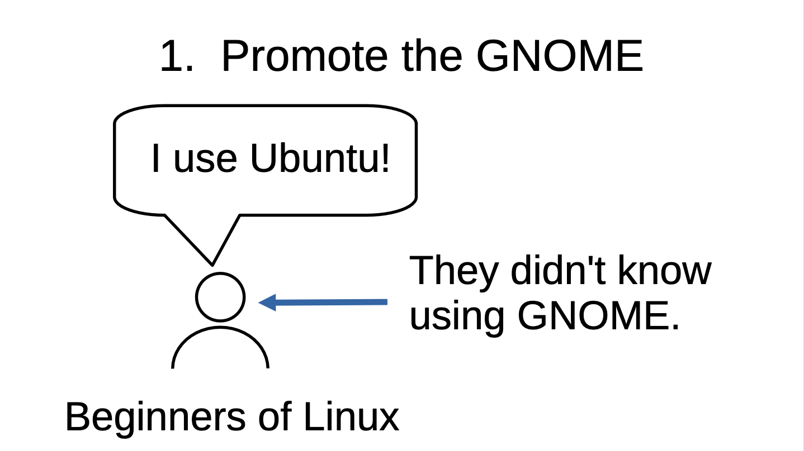
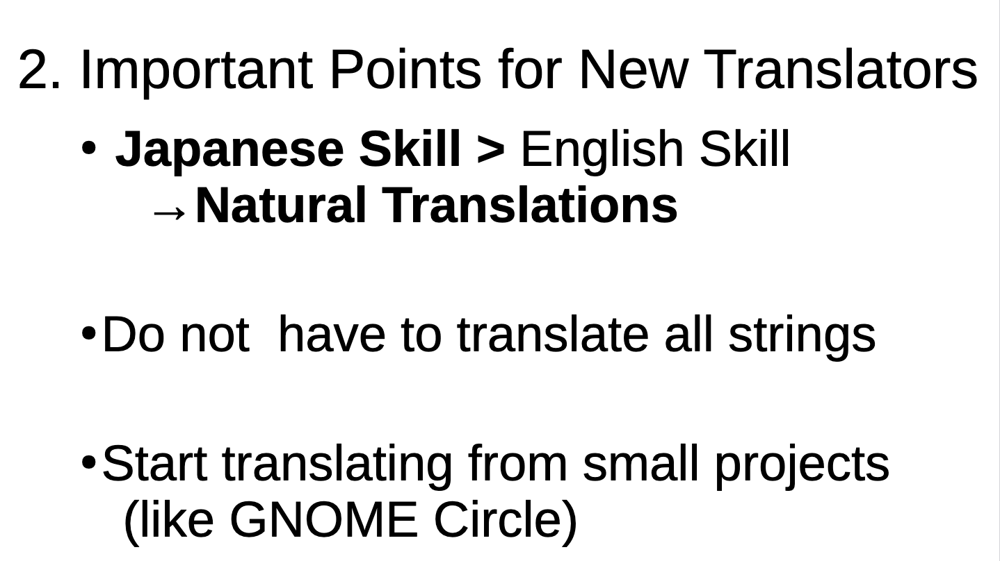
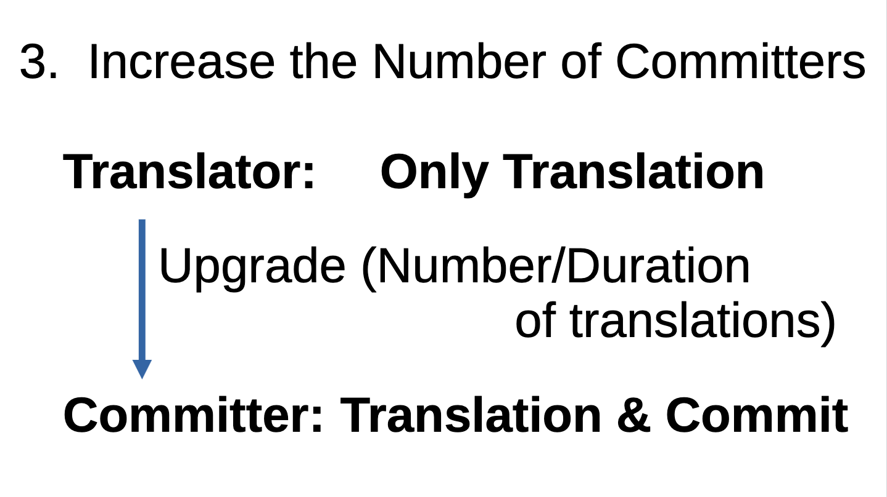
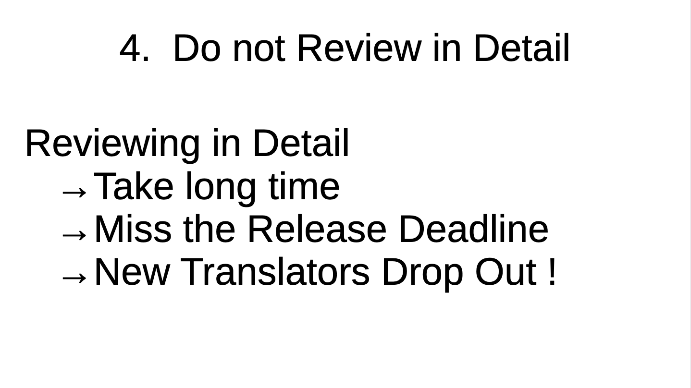

GNOME Asia Summit 2025 Tokyo に参加しました。
GNOMEのトラベルスポンサーシップの支援を受けました。

東京の飯田橋にあるIIJの本社で行われました。
12/13と12/14の2日間のイベントで、私は1日目のみ参加しました。
1日目の最後に行われたライトニングトークで、「How to Manage a Translation Team」という内容で発表しました。GNOMEの日本語翻訳チームのコーディネーターになりましたので、翻訳チームの管理方法について発表しました。
初めてのライトニングトークと英語の発表でしたので、緊張しましたが、無事に発表できました。

https://events.gnome.org/event/303/contributions/1330/

https://libojapan.connpass.com/event/372838/

前任の日本語翻訳チームのコーディネーターの方とも初めてお会いして、コミュニティについて色々と話しました。

一日目の夜に、懇親会がありました。LibreOffice Asia Confと同時開催していたため、LibreOfficeのコミュニティの方とお話をしました。LibreOfficeのコミュニティはGNOMEのコミュニティよりも活発だなと感じました。
GNOMEのコミュニティもリアルなイベントの開催をしても良いかなと思いましたが、コミュニティの人数が少ないので、なかなか難しそうです。オープンソースカンファレンスに参加したいなという話も出ました。LibreOffice以外のUbuntuやDebianなどの他のコミュニティの話も、聞くことができて参考になりました。

## 発表内容
実際に発表したスライドは、以下のリンクから確認できます。
https://events.gnome.org/event/303/contributions/1330/attachments/585/1366/oyamadajun.pdf

「翻訳チームをマネージメントする方法」と言う内容で発表します。

GNOMEというものを知ってもらうことです。Linux初心者は、Ubuntuを使っていることが多いです。彼らはUbuntuを使っていることは知っていますが、いつも使っているデスクトップシェルやアプリがGNOMEであることは知りません。このようなLinux初心者に対して、GNOMEを宣伝する必要があります。

次に、新しい翻訳者に伝えたい重要な点を紹介します。一つ目は、英語の能力よりも、日本語の能力が大切ということです。最終的なUIは日本語であるため、日本語の能力が高ければ自然なUIになります。二つ目は、小規模なプロジェクトから翻訳を始めることです。例えばGNOME Circleのアプリなどが最適です。

コミット権限を持つ人を増やすことが大事です。
翻訳者とコミッターという二つの権限があります。
翻訳者は、翻訳のアップロードのみができ、翻訳の反映はコミッターが行います。
翻訳した回数や期間が一定に達したら、翻訳者をコミッターにアップグレードしていくことで、コミッターを増やす必要があります。
翻訳したものを自分でコミットできるようになるので、効率が良くなります。

詳細にレビューしないことも大切です。
詳細にレビューしすぎると、時間がかかり、リリースの期限を過ぎてしまいます。
翻訳がすぐに製品に反映されないため、新しい翻訳者はやる気をなくして、翻訳をやめてしまいます。