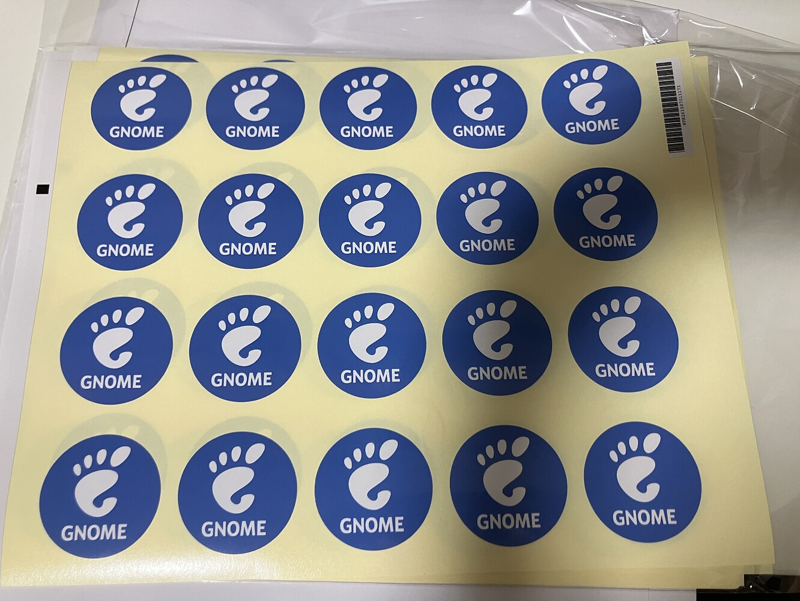
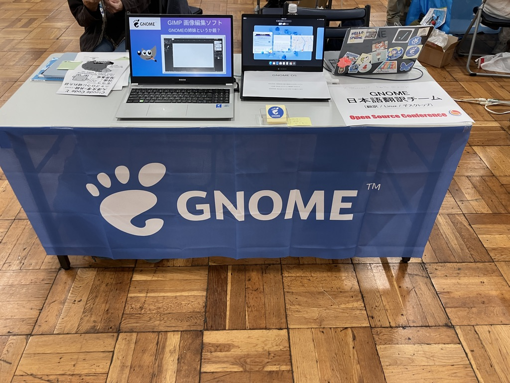

[Open Source Conference 2026 Tokyo/Fall](https://event.ospn.jp/osc2026-fall/)に「GNOME 日本語翻訳チーム」として出展をいたしました。
東京までの旅費はGNOMEのトラベルスポンサーシップを使用しました。ありがとうございます。

2026年10月17日(土)に東京の浅草にある東京都立産業貿易センター台東館で行われました。Open Source Conference(OSC)は、様々なオープンソースのコミュニティや個人プロジェクトが出展するイベントです。我々は、GNOMEの日本語翻訳チームの活動を紹介するために、ブース展示を行いました。「GNOME 日本語翻訳チーム」が参加するのは2011年ぶりだそうです！なんと15年前！！

一年ほど前のGNOME Asia Summitにて、Open Source Conferenceに出展しないかと誘っていただき、今回出展しました。

今回のために配布用のシール(300枚)と、テーブルの前に貼り付ける用の旗をラクスルで発注しました。シールは一枚ごとにカットしてもらうと値段が倍ぐらいになるので、自分でカットすることにしました。旗は、展示場みたいなところでは消防法により、防火素材にしなければいけないらしく、少し高い防火のものを発注しました。思ったよりペラペラ。

当日は、私と普段翻訳を行なっているメンバー2名の計3人で参加しました。お二人、参加していただきありがとうございます。
ステッカーを配布したり、スライドを使ってGNOMEとGIMPの翻訳について紹介しました。
たくさんの方にブースに来ていただき、ありがとうございました。
GNOMEの知らない方もいました。Linuxを使ったことがあっても使っているデスクトップシェルやアプリがGNOMEであると知らない場合もあると思います。GNOMEのことを知ってもらう良い機会になったと思います。

他のブースも見て回りましたが、特に個人で活動している方のブースが面白かったです。声でロボットを操作するプロジェクトだったり、ゲームのテストを行うためのライブラリだったり。
私も、趣味で色々なものを作ってオープンソースとして公開しているので、興味が湧きました。個人でOpen Source Conferenceに参加するというイメージがありませんでした。

イベント終了後に、懇親会がありました。古くからオープンソースに関わっておられる方々とお話しすることができ、貴重な経験になりました。

静岡大学のITS(大学のPCのサポートやIT開発を行なっている学生団体)の方が、オープンソースに参加している人にインタビューをしてまとめる活動をやっていることを知りました。
なかなか面白い試みだと思いますし、他の方がどういう経緯でオープンソース活動を始めたのかはすごく気になります。応援しています。
私も後日インタビューに答えてきました。自分語りをする機会は普段ないので、気持ちいいですね。色々話せて面白かったです。なぜITに興味を持ったのかとか、今の活動の内容とか色々話しました。

こんな感じで、他のオープンソースに参加している方と関われるのは、面白いですね。
私自身、イベントに参加するのとかも面倒くさがりですが、参加してみると意外と楽しかったりするものです。ただ次いつ出展するかは未定です。。。

ちなみにイベントの数日後コロナになりました。とほほ
